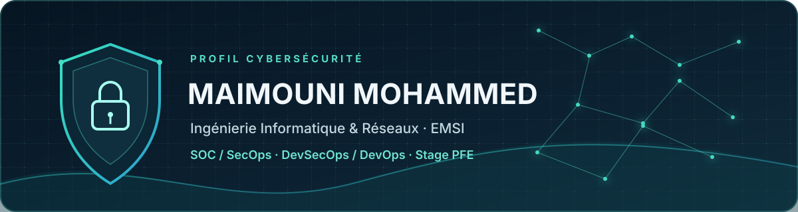

  

  
  
  

  <a href="https://www.linkedin.com/in/mohammed-maimouni/">LinkedIn</a> &nbsp;|&nbsp;
  <a href="mailto:simohammed.maimouni@gmail.com">Email</a> &nbsp;|&nbsp;
  <a href="https://github.com/simohowaanaa">GitHub</a>

---

## Profil

Élève-ingénieur en 5e année à l’**École Marocaine des Sciences de l’Ingénieur (EMSI)**, filière **Ingénierie Informatique & Réseaux**, option **Cybersécurité & Infrastructures Réseaux**.

Mes stages chez **DATAPROTECT** et **Amendis** m’ont permis de pratiquer l’analyse de journaux, la détection de menaces Active Directory, la conteneurisation et l’intégration de contrôles de sécurité dans un pipeline CI.

> **Objectif :** stage de fin d’études (PFE) en cybersécurité, SOC/SecOps, DevSecOps ou sécurité des infrastructures.

## Postes ciblés

| SOC et cybersécurité | DevOps et infrastructures |
| --- | --- |
| Analyste SOC junior / **SOC Analyst L1** | Stagiaire PFE SecOps / DevSecOps |
| Analyste SecOps / Security Operations Analyst | Ingénieur DevSecOps junior |
| Analyste cybersécurité junior / IT Security Analyst | Ingénieur DevOps junior |
| Auditeur IT junior / **IT Auditor** | Administrateur systèmes et réseaux junior |
| Auditeur cybersécurité junior / Analyste GRC | Ingénieur sécurité réseau ou cloud junior |
| Analyste détection / gestion des vulnérabilités |  |
| Pentester junior |  |

## Expériences

### Stagiaire Analyste SOC — DATAPROTECT
*Casablanca · hybride · juillet–août 2026*

- Déploiement sur Azure d’un laboratoire Active Directory basé sur GOAD-Light.
- Centralisation et analyse de journaux Windows avec Wazuh.
- Simulation de Kerberoasting, Pass-the-Hash et DCSync.
- Création de règles de détection MITRE ATT&CK, triage et investigation d’alertes.
- Expérimentation de Python et Isolation Forest pour repérer des comportements anormaux et réduire les faux positifs.

### Stagiaire IT — Initiation DevSecOps — Amendis
*Tanger-Tétouan-Al Hoceïma · sur site · juillet–août 2025*

- Conteneurisation d’un serveur NGINX avec Docker et Alpine Linux.
- Gestion du code avec Git/GitHub et mise en place d’un pipeline CI.
- Intégration de Trivy pour analyser les vulnérabilités des images conteneurisées.
- Configuration Linux et analyse de journaux système.

## Formation

**Diplôme d’ingénieur en Ingénierie Informatique & Réseaux — EMSI, Tanger**  
*Septembre 2022–juin 2027 · Option Cybersécurité & Infrastructures Réseaux*

Le cursus couvre le développement logiciel, le génie logiciel, les systèmes Linux/Windows, le cloud, les réseaux, la cybersécurité, les bases de données et l’intelligence artificielle. Il comprend des projets pratiques, des stages et un projet de fin d’études.

## Compétences

**SOC et SecOps**  
Wazuh, Elastic Stack, analyse de journaux, triage, investigation et MITRE ATT&CK.

**DevSecOps et DevOps**  
Git, GitHub, Docker, Linux, intégration continue et Trivy.

**Systèmes, réseaux et audit**  
Windows, Active Directory, TCP/IP, Nmap, Burp Suite, forensic et analyse des risques.

**Développement et données**  
Python, Bash, PowerShell, SQL; bases académiques en C++, Java, .NET, Angular, React et machine learning.

  
  
  
  
  
  

## Projets

### SOC, détection et réponse à incident

- **[Analyseur de phishing SOC N1](https://github.com/simohowaanaa/soc1-phishing-email-analyzer)** — analyse locale de fichiers .eml, repérage d’indices et génération de rapports.
- **[AI-Driven AD Attack Detection](https://github.com/simohowaanaa/ai-driven-ad-attack-detection)** — laboratoire de simulation et détection de scénarios Active Directory.
- **[Réponse à incident cyber — AtlasGrid](https://github.com/simohowaanaa/reponse-a-incident-cyber)** — étude de cas DFIR, gestion de crise et continuité d’activité.
- **[LetsDefend Write-ups](https://github.com/simohowaanaa/LetsDefend-Writeups)** — analyses Blue Team : phishing, PCAP, malware, forensic et Sigma.
- **[100 Days of Blue Team](https://github.com/simohowaanaa/100-Days-of-Blue-Team)** — laboratoires de forensic, threat intelligence et analyse de malware.

### Systèmes, réseaux et sécurité

- **[Active Directory multi-sites](https://github.com/simohowaanaa/sbtx-active-directory-multisites)** — infrastructure Active Directory multi-sites.
- **[Darknet Analyst Lab](https://github.com/simohowaanaa/darknet-analyst-lab)** — environnement isolé pour la veille CTI et l’OSINT.
- **[CupidStrike](https://github.com/simohowaanaa/CupidStrike-Reversible-Desktop-Hijack-Payload)** — preuve de concept éducative en Python autour des risques de sécurité.

## Certifications

- Foundations of Governance, Risk, and Compliance — ISC2
- Microsoft SC-900 Exam Preparation and Practice
- Microsoft SC-200 — préparation en cours

---

  <strong>Disponible pour un stage PFE en cybersécurité, SOC/SecOps ou DevSecOps.</strong> 
  <a href="mailto:simohammed.maimouni@gmail.com">Me contacter</a> &nbsp;|&nbsp;
  <a href="https://www.linkedin.com/in/mohammed-maimouni/">LinkedIn</a>

